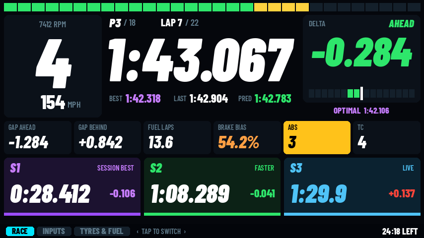
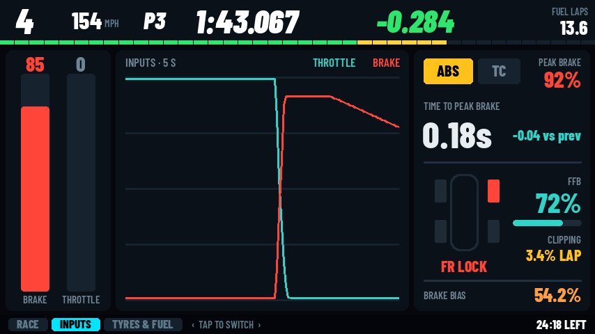
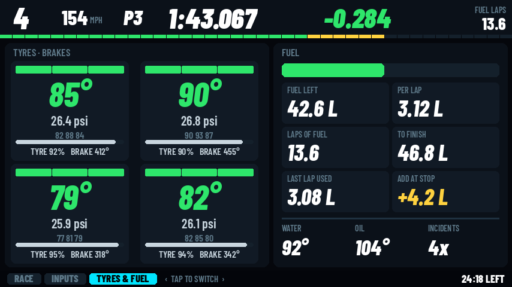
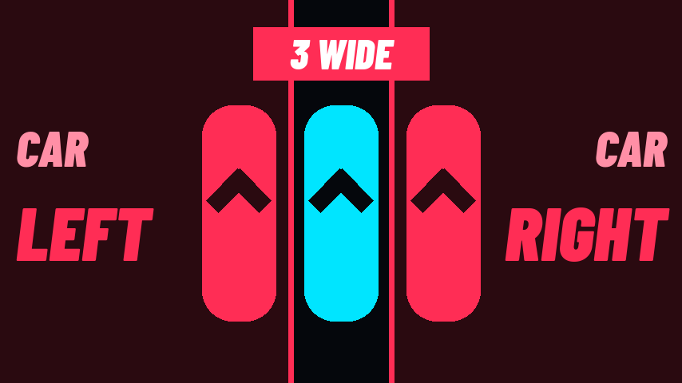
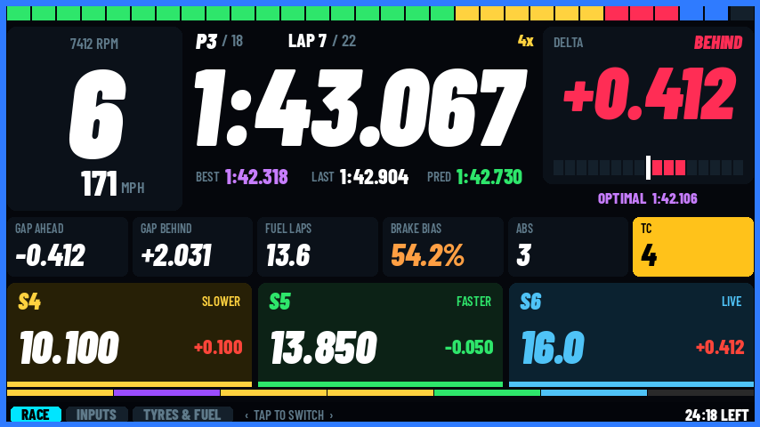
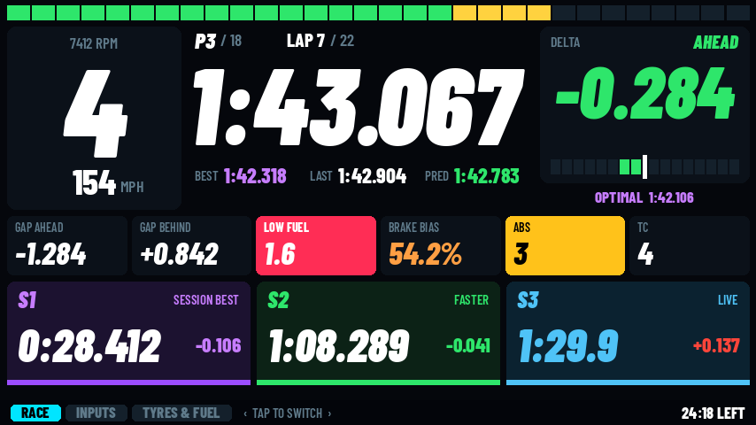
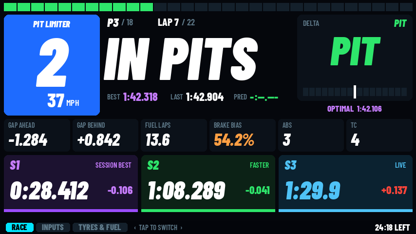

# RCD — Race Control Dash

A complete SimHub race dash for **854 × 480 screens** (4.3"–5", e.g. Conspit CSD, VoCore). Everything a driver needs on three pages, with touch to flip between them.

**By DIRTYNUT** · Free for personal use · Not open source — see [License](#license)

<p align="center">
  <a href="https://discord.gg/TwagTfRfvJ"></a>
</p>

<h2 align="center"><a href="https://discord.gg/TwagTfRfvJ">👉 Join the DIRTYNUT Discord 👈</a></h2>

---

## Compatibility

| | |
|---|---|
| **Made for** | 854 × 480 screens, 4.3"–5": Conspit CSD, VoCore and similar SimHub USB / touch screens |
| **Other sizes** | SimHub scales the dash to fit (e.g. 800 × 480 4.3" screens) |
| **Touch** | Optional. Tap to flip pages, or map a button / knob instead |
| **Requires** | SimHub on a Windows PC |

## The pages

Tap the screen to flip **Race → Inputs → Tyres & Fuel → Race**. The tab bar along the bottom shows which page you're on.

### Race



Gear, speed (in SimHub's unit), RPM number and RPM bar, pit limiter, position, lap / total, current lap, best / last / predicted lap, delta with delta bar, optimal lap (your best sectors added up), gap to the car ahead and behind, laps of fuel left, brake bias, ABS and TC level, sector panels and time or laps left in the session.

### Inputs



Brake / throttle bars, 5-second input trace, ABS and TC lights, peak brake %, time to peak brake (vs your previous braking zone), wheel lock, FFB % and FFB clipping % for the lap, brake bias.

### Tyres & Fuel



Tyre temps (inside / middle / outside), pressures, tyre left %, brake temps, fuel left, fuel per lap, laps of fuel, fuel used last lap, fuel needed to finish, fuel to add at the stop, water and oil temp, iRacing incidents.

Pages 2 and 3 keep gear, speed, position, lap time, delta and fuel laps across the top, so you never lose the basics.

---

## On every page

### Spotter

When a car is alongside, the screen switches to CAR LEFT / CAR RIGHT / 3 WIDE, then switches back half a second after the car clears.



### Flags

The edge of the screen lights up in the flag colour: yellow, blue, white (white / chequered) or orange (black flag).



### Low fuel

The fuel boxes turn red with **LOW FUEL** when SimHub's low-fuel alert is on, with under 2 laps of fuel, or under 10% in the tank before there's a fuel-per-lap figure.



### Pit limiter

The gear box turns blue with **PIT LIMITER**, and timing shows **IN PITS**.



---

## Details

### RPM bar

- **iRacing:** follows the car's own shift lights — starts at the first light and turns blue at the shift point, like the in-car lights.
- **Other sims:** runs up to the car's max RPM from the game and turns blue just before the limiter.

### Sectors

- Split times like the game, colored vs your best lap: purple = session best, green = faster, yellow = slower, light blue = the sector you're in.
- **iRacing tracks with more than 3 sectors:** the panels show the two sectors before the one you're in plus the live one (e.g. S4 / S5 / S6 LIVE), and a thin strip shows every sector of the lap.
- If you have the **Lovely plugin** installed, iRacing sector times come from it; otherwise the dash times the sectors itself.

### Delta and timing

- **Le Mans Ultimate:** delta comes straight from the game's own telemetry, so it matches the in-game delta to 3 decimals.
- **iRacing:** uses iRacing's own delta to your session best.
- **Other sims:** SimHub's delta.
- Like the game, the delta starts after your first full timed lap.
- Timing shows **IN PITS** in the garage / pit lane and **OUT LAP** on the out lap, and starts when you cross the line.

Where a sim doesn't send a value, that box shows `--`.

---

## Download

**Latest: v1.0** — **[download RCD_Race_Control_Dash_v1.0.zip](RCD_Race_Control_Dash_v1.0.zip?raw=1)**, then follow the install steps below. See [CHANGELOG.md](CHANGELOG.md) for what's new.

Questions, bugs or ideas? **[Join the DIRTYNUT Discord](https://discord.gg/TwagTfRfvJ)**

---

## Install

### Step 1 — Install the dash

1. Close SimHub completely (also right-click its icon in the system tray by the clock and choose **Exit**, if it's there).
2. Extract the zip, then copy the `RCD - Race Control Dash` folder into SimHub's DashTemplates folder:
   ```
   C:\Program Files (x86)\SimHub\DashTemplates\
   ```
   If you installed SimHub somewhere else, use `DashTemplates` inside that SimHub folder. If you're updating, choose **Replace the files**.

### Step 2 — Install the fonts (once)

The dash uses the **Barlow Condensed** font. Without it SimHub swaps in a default font and the layout won't look right.

1. Open the dash's `_SHFonts` folder:
   ```
   DashTemplates\RCD - Race Control Dash\_SHFonts
   ```
2. Select all six `.ttf` files (click one, then press **Ctrl+A**).
3. Right-click them and choose **Install for all users**.
   On Windows 11 you may need to click **Show more options** first.
   Use **Install for all users**, not just **Install** — SimHub may not see fonts that are installed for one user only.
4. Click **Yes** if Windows asks for permission.

If you already installed them for another DIRTYNUT dash, skip this step.

Fonts included: Barlow Condensed SemiBold, SemiBold Italic, ExtraBold, ExtraBold Italic, Black, Black Italic. They're in the zip's `_SHFonts` folder and also in the [fonts](fonts) folder of this repo if you want to grab them on their own.

### Step 3 — Start SimHub and assign the dash

1. Start SimHub. The dash appears in Dash Studio under **RCD**.
2. In SimHub's settings for your screen, pick **RCD - Race Control Dash**.

### Step 4 — Switching pages

- **Touchscreens:** tap the screen to flip pages. This uses SimHub's standard touch setting: in your screen's **Screen settings**, under **Touchscreen**, turn on **Enable touchscreen** with **Fallback: simplified touch mode (left/right page change)** selected (the default).
- **Knob or button:** map it to the next screen / previous screen controls in your screen's device controls in SimHub.

---

## Troubleshooting

- **Fonts look wrong:** redo Step 2 with **Install for all users**, then fully exit and restart SimHub.
- **Tapping doesn't flip pages:** check Step 4. If touch is set to **advanced touch mode**, switch it back to simplified.
- **Delta shows `-.---`:** normal until you've completed one timed lap after your out lap, same as in the game.
- **Fuel per lap / to finish shows `--`:** it needs one full lap on track first.
- **Spotter never shows:** it uses SimHub's spotter, which needs to be supported by the sim. It stays off while you're stopped (garage, pit box).
- **Something else looks off:** post a photo of the screen in the [DIRTYNUT Discord](https://discord.gg/TwagTfRfvJ) along with which version and sim you're using.

---

## License

**Copyright © 2026 DIRTYNUT. All rights reserved.**

This is **not** open-source software. The dashboard is shared free of charge for personal use only. See [LICENSE.txt](LICENSE.txt) for the full terms. In short:

**You may**
- Download, install and use the dashboard on your own sim rig for personal, non-commercial use.
- Change settings or tweak the dashboard for your own private use on your own rig.
- Share a **link** to the original post or download page.

**You may not**
- Copy, re-upload, redistribute, mirror or share the files (original or modified) with anyone else.
- Sell, rent, license or charge for access to them in any way, including paid downloads, memberships, Patreon-style tiers, or bundling with any product, hardware or service.
- Publish or distribute modified versions, or anything derived from these files.
- Use the files, scripts, layouts or designs to make a competing or look-alike dashboard product, free or paid.
- Remove or change the license, copyright notice, or author credit.

### Third-party components

- The bundled **Barlow Condensed** fonts are **not** covered by this license. They are Copyright 2017 The Barlow Project Authors and licensed under the **SIL Open Font License 1.1** (see [fonts/OFL.txt](fonts/OFL.txt), also next to the fonts in the zip).
- SimHub, Conspit, CSD, VoCore, iRacing, Le Mans Ultimate and other names are trademarks of their respective owners. This dashboard is an independent project and is not affiliated with or endorsed by them.

Provided "as is", without warranty of any kind. For any use not covered here, ask the author first.

**Owner: DIRTYNUT**
